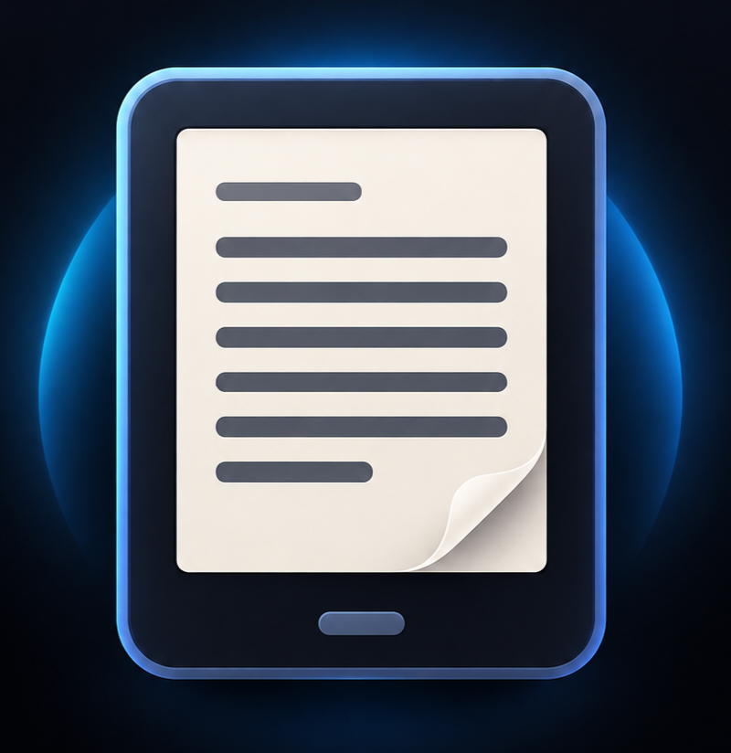

# Readle

<p align="center"></p>

An original, offline-first Android reader for **PDF, EPUB, MOBI/AZW, FB2, DOCX, RTF, HTML, Markdown, TXT and CBZ comics**.
Package: `com.readle.app` · Kotlin · Jetpack Compose (Material 3) · MVVM · Room · DataStore · Storage Access Framework.

Readle requests **no permissions** (no storage, no internet). It reads only files and folders the user picks through the system picker.

## Build and run

Requirements: JDK 17, Android SDK (platform 35), network access for Gradle dependencies.

```bash
./gradlew :app:testDebugUnitTest     # unit tests
./gradlew :app:assembleDebug         # app/build/outputs/apk/debug/app-debug.apk
./gradlew :app:installDebug          # install on a connected device (minSdk 26)
```

GitHub Actions (`.github/workflows/build.yml`) runs the tests, builds a shrunk (R8 + resource shrinking) release APK and AAB, signs them with your keystore from repository secrets, and uploads them. See the secrets list in the file's header comments of your setup notes: `ANDROID_KEYSTORE`, `ANDROID_KEYSTORE_PASSWORD`, `ANDROID_KEYSTORE_ALIAS`, `ANDROID_KEY_PASSWORD`.

## Features

**Library**: add files or whole folders (recursive scan, cancellable), grid / compact / detailed layouts, search (title, author, file name), sort (8 keys, either direction), filters (format, status, favorites, duplicates), Recent, favorites, collections (create / rename / delete / reorder), smart lists (Favorites, Reading, Finished, To read, Possible duplicates, Unavailable files), authors and series groups, folder list with a real directory browser, Downloads shortcut, multi-select batch actions, details screen (edit title/author/series, rename file, share, relink a moved file), duplicate detection (size + hash of the first 64 KB), covers extracted from EPUB and PDF page 1.

**Reading**: every format except PDF is converted to HTML chapters and shown by one reflow engine; PDF follows the same setting: continuous scroll, or one whole page at a time (tap the edges or swipe sideways). Saved position per book, bookmarks, table of contents (EPUB), in-book search (EPUB/TXT), back-stack after jumps, progress slider, themes (day, night, sepia, night contrast, sepia contrast), font, size, line and paragraph spacing, margins, alignment, per-book text settings, continuous scroll (with a Previous-chapter button at the start of each chapter) or real pages (text laid out in screen-sized pages with space above and below; tap the edges or swipe), orientation, brightness, keep-screen-on, immersive mode. PDF: pinch and double-tap zoom (zooms around your fingers, re-rendered sharp without white flashes), pan, fit to width (scrolling) or fit whole page (pages mode), a one-tap switch between scrolling and pages mode, page thumbnails, go to page.

**Study tools (EPUB/TXT)**: highlights in four colors, notes, quotes, tap a highlight to edit, anchors are character offsets so they survive font/size changes, all-books Bookmarks & notes screen, Markdown export (system "Create document"), read aloud with Android TTS (speed control, auto-advance across chapters), built-in offline **Define** card (Princeton WordNet 3.1, with base-form lookup such as running→run, mice→mouse; optional "Speak" via Android TTS, shown only when an English voice exists; WordNet has no recorded pronunciations), fallback to any installed dictionary app (`PROCESS_TEXT`), saved vocabulary.

**Accessibility and privacy**: WCAG-checked colors, high-contrast mode, large touch targets, reduced motion, content descriptions on all icon buttons, no ads / analytics / accounts, clear-cache / clear-history / delete-all-data with confirmation.

## Honest limitations

- **PDF text layer**: PDFs are drawn by Android's `PdfRenderer`, which exposes no text. So no text selection, highlights, notes, search or outline in PDFs. Bookmarks, zoom and page navigation work.
- **No OCR.** Scanned PDFs show their images only.
- **Formats**: PDF, EPUB (DRM-free), MOBI/AZW/PRC (MOBI 6: plain or PalmDOC-compressed, no DRM), FB2, DOCX, RTF, HTML, Markdown, TXT, CBZ. Not supported (a clear message is shown): KF8-only AZW3, HUFF/CDIC MOBI, DRM books, DJVU, CBR/CB7, old binary DOC, password-protected files. Convert those to EPUB or PDF (for example with Calibre).
- **Converted formats** keep headings, emphasis, lists, tables, links and images where the source has them. DOCX headers/footers/footnotes/text boxes, RTF images/tables, and HTML styling/scripts are dropped. Comics (CBZ) have no text, so no search, highlights or read-aloud.
- **TTS** is foreground only: it stops when you leave the reader (no media notification / service). Voices come from the engines installed on the device. "Pause" stops and resumes from the same paragraph.
- **EPUB** is rendered in a locked-down WebView (book scripts blocked by CSP, no network, no file access). Fixed-layout EPUBs are shown as reflowable text.
- The built-in dictionary is English only (no names, no other languages); the first lookup copies ~15 MB to app-private storage. Regenerate it with `python3 -I tools/build_wordnet.py <wordnet dict dir> app/src/main/assets/wordnet`.
- Opening a document via "Open with" from another app works for the session; if that app granted only a temporary permission, the file may show as unavailable after a restart and can be relinked from Details.
- PDF zoom is capped (8×); zoomed views are rendered per visible region to keep memory bounded.

## Architecture

```
app/src/main/java/com/readle/app
  domain/        pure Kotlin: formats, locators, library filter/sort/scope logic, typography, anchors, export
  data/db        Room v1 (documents, locations, progress, collections, bookmarks, annotations, history, per-book settings, vocabulary)
  data/prefs     DataStore app settings
  data/repo      Library / Reader / Collection repositories, LibraryManager (scan, relink, delete)
  files/         SAF helpers, bounded file + cover caches, metadata extraction
  reader/        ReaderViewModel + ReaderScreen; reflow/ (EPUB/TXT engine, WebView host), pdf/, tts/
  ui/            theme + tokens, shared components, library, browse (collections, folders, notes, vocabulary), settings, navigation
```

Room has `exportSchema` on (schemas in `app/schemas`) and no destructive migration.

## Verification status (please read)

This project was written in an environment **without the Android SDK or Maven access**, so the Android layer has **not been compiled or run**. What *was* verified:

- `tools/run-jvm-tests.sh`: compiles the Android-free code (domain, EPUB/TXT engine, design tokens) with Kotlin 2.0.21 and runs **112 JUnit tests**: all pass (library filtering/sorting/scopes, EPUB parsing incl. DRM and malformed input, anchors, MOBI/FB2/DOCX/RTF/HTML/Markdown/CBZ conversion, CSS/HTML injection, search, TTS chunking, contrast ratios, formatters).
- `tools/webtest.js` (+ `GenPage.kt`): drives the exact generated reader page in headless Chromium with a stub bridge: **91 checks** (position restore, CSP blocking book scripts, selection offsets, highlights across nested elements, find, taps, footer navigation, previous-chapter button, paged layout and page turning, live restyle). Run with `tools/run-web-tests.sh` after `tools/run-jvm-tests.sh`.
- Static cross-file import resolution for every `com.readle.app` import.

Not verified: Compose UI, ViewModels, WebView glue, PdfRenderer, TTS and SAF on a real device. Expect to fix a handful of compile errors on the first Gradle build; run the CI workflow or `./gradlew :app:assembleDebug` and then test on a device.

## Third-party data

WordNet 3.1, Copyright 2011 Princeton University. Licence text: `app/src/main/assets/wordnet/WORDNET-LICENSE.txt`.

## License

Readle 1.0 by Karthik Hegde, https://github.com/karthikhegde25/Readle, is free software licensed under the **GNU General Public License v3.0** (see `LICENSE`). Third-party libraries (Android Jetpack, Kotlin, kotlinx.coroutines) are Apache License 2.0.
